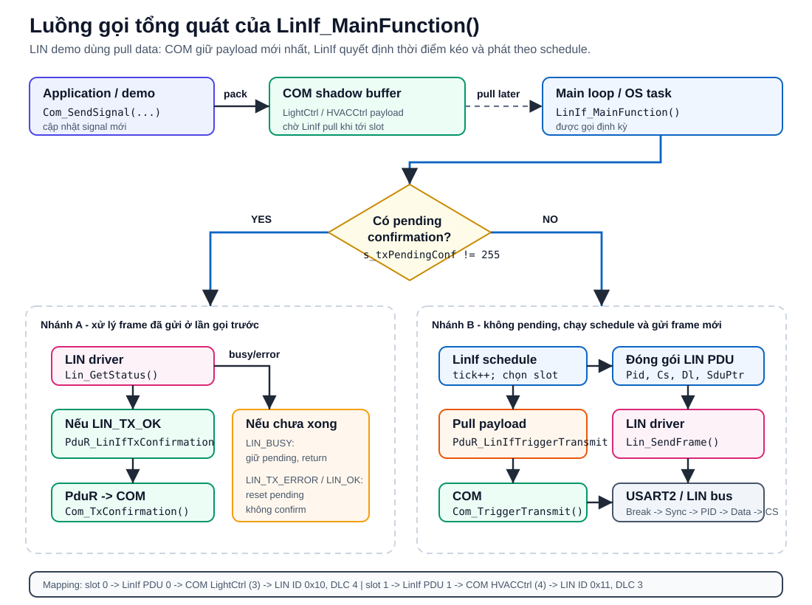

# Tài liệu chi tiết: LinIf và LinIf_MainFunction

Tài liệu này giải thích module `autosar/linif`, tập trung vào hàm `LinIf_MainFunction()` trong `autosar/linif/LinIf.c` và các API mà hàm này gọi xuống/gọi lên trong COM stack.

## 1. Vai trò của LinIf trong demo

`LinIf` là lớp LIN Interface nằm giữa:

- Tầng trên: `PduR` và `COM`
- Tầng dưới: `Lin` driver/MCAL, ở đây chạy trên USART2 của STM32F103

Với LIN, master thường truyền theo lịch cố định. Vì vậy demo này dùng mô hình **pull data**:

1. Application cập nhật signal vào shadow buffer của `COM` bằng `Com_SendSignal()`.
2. `LinIf_MainFunction()` được gọi định kỳ từ vòng lặp chính.
3. Khi tới slot LIN, `LinIf` gọi `PduR_LinIfTriggerTransmit()` để kéo payload mới nhất từ `COM`.
4. `LinIf` đóng gói thông tin frame thành `Lin_PduType`.
5. `LinIf` gọi `Lin_SendFrame()` để driver tạo frame LIN trên UART.
6. Ở lần gọi sau, `LinIf` kiểm tra trạng thái bằng `Lin_GetStatus()`, rồi gọi `PduR_LinIfTxConfirmation()` nếu truyền xong.

Điểm quan trọng: trong demo này `LinIf_Transmit()` cố tình trả `E_NOT_OK`. Nghĩa là đường push `COM -> PduR_ComTransmit() -> LinIf_Transmit()` không phải đường truyền chính cho LIN unconditional frame. Đường chính là `LinIf_MainFunction()` chủ động pull data theo schedule.

## 2. Các file liên quan

| File | Vai trò |
|---|---|
| `autosar/linif/LinIf.h` | Public API của LinIf: `LinIf_Init`, `LinIf_Transmit`, `LinIf_MainFunction`, `LinIf_GotoSleep`, `LinIf_Wakeup` |
| `autosar/linif/LinIf.c` | Cài đặt LinIf, schedule table giả lập, buffer cục bộ và trạng thái pending confirmation |
| `autosar/pdur/PduR_LinIf.h` | Header callback/API giữa LinIf và PduR |
| `autosar/pdur/PduR.c` | Cài đặt `PduR_LinIfTriggerTransmit()` và `PduR_LinIfTxConfirmation()` |
| `config/PduR_Cfg.c` | Mapping LinIf PDU ID sang COM I-PDU ID |
| `autosar/com/Com.c` | `Com_TriggerTransmit()` copy payload từ COM shadow buffer sang buffer của LinIf |
| `autosar/lin/Lin.c` | `Lin_SendFrame()` tạo Break, Sync, PID, Data, Checksum qua USART2 |
| `example/lin_tx_demo.c` | Demo main loop: cập nhật signal rồi gọi `LinIf_MainFunction()` |

## 3. Cấu hình nội bộ của LinIf

Trong `LinIf.c`, cấu hình PDU được đặt tĩnh:

| `slotId` | `LinIfTxPduId` | LIN Frame ID | DLC | Ý nghĩa |
|---:|---:|---:|---:|---|
| `0` | `0` | `0x10` | `4` | `LightCtrl` |
| `1` | `1` | `0x11` | `3` | `HVACCtrl` |

`LinFrameId` ở đây là LIN frame ID 6-bit, không phải PID đã có parity. Khi xuống `Lin_SendFrame()`, driver gọi `prv_CalcPID(PduInfoPtr->Pid & 0x3F)` để tính PID thật sự. Ví dụ `0x10` sẽ được phát thành PID `0x50`.

Các biến trạng thái chính:

| Biến | Ý nghĩa |
|---|---|
| `s_linIfInited` | Chặn `LinIf_MainFunction()` chạy trước khi `LinIf_Init()` |
| `s_txPendingConf` | Lưu `LinIfTxPduId` đang chờ driver báo truyền xong |
| `s_local_tx_buffer[8]` | Buffer cục bộ để nhận payload được pull từ COM |
| `tick` trong `LinIf_MainFunction()` | Bộ đếm giả lập schedule table |

## 4. Luồng gọi tổng quát

{ width=100% }

Hình trên tách rõ hai nhánh chính: nếu đang có frame chờ confirm thì `LinIf_MainFunction()` ưu tiên hỏi trạng thái driver và báo ngược lên PduR/COM; nếu không có pending thì hàm tăng `tick`, chọn slot, pull payload từ COM qua PduR, đóng gói `Lin_PduType`, rồi gọi `Lin_SendFrame()` xuống LIN driver.

## 5. Phân tích `LinIf_MainFunction()` theo từng đoạn

### 5.1. Chặn khi chưa init

```c
if (!s_linIfInited) return;
```

Nếu chưa gọi `LinIf_Init()`, hàm thoát ngay. `LinIf_Init()` gọi `Lin_Init()` để cấu hình LIN driver/USART2, reset pending confirmation, rồi set `s_linIfInited = TRUE`.

### 5.2. Ưu tiên xử lý confirmation của frame trước

```c
if (s_txPendingConf != LINIF_INVALID_PDU) {
    Lin_StatusType st = Lin_GetStatus(LINIF_CHANNEL, NULL);
    if (st == LIN_TX_OK) {
        PduR_LinIfTxConfirmation(s_txPendingConf);
        s_txPendingConf = LINIF_INVALID_PDU;
    } else if (st == LIN_TX_ERROR || st == LIN_OK) {
        s_txPendingConf = LINIF_INVALID_PDU;
    }
    return;
}
```

Ý nghĩa:

- Nếu `s_txPendingConf` khác `255`, LinIf hiểu rằng lần trước đã gọi `Lin_SendFrame()` thành công và đang chờ driver xác nhận.
- `Lin_GetStatus(0, NULL)` hỏi trạng thái driver.
- Nếu trạng thái là `LIN_TX_OK`, LinIf gọi `PduR_LinIfTxConfirmation()` để báo ngược lên PduR/COM rằng I-PDU đã truyền xong.
- Nếu trạng thái là `LIN_TX_ERROR` hoặc `LIN_OK`, demo reset pending mà không báo confirm.
- Nếu trạng thái đang bận như `LIN_TX_BUSY` hoặc `LIN_BUSY`, code không reset pending, sau đó `return`; lần gọi sau sẽ kiểm tra tiếp.

Lưu ý theo code hiện tại: nếu driver trả một trạng thái lỗi khác như `LIN_NOT_OK`, nhánh này không reset pending. Driver hiện tại gần như không tạo trạng thái đó trong luồng TX bình thường, nhưng nếu mở rộng driver thì nên xử lý rõ để tránh kẹt pending.

### 5.3. Tăng tick và chọn slot

```c
static uint32 tick = 0;
tick++;

PduIdType slotId = LINIF_INVALID_PDU;

if (tick % 10 == 0) {
    slotId = 0u;
} else if (tick % 10 == 5) {
    slotId = 1u;
}
```

Schedule table giả lập:

- `tick % 10 == 0`: gửi `slotId = 0`, tức `LightCtrl`
- `tick % 10 == 5`: gửi `slotId = 1`, tức `HVACCtrl`
- Các tick còn lại: không gửi frame nào

Trong `example/lin_tx_demo.c`, vòng lặp gọi `LinIf_MainFunction()` rồi delay `100 ms`. Nếu bỏ qua confirmation, có thể hiểu gần đúng là:

- `HVACCtrl`: mỗi 10 tick, lệch tại tick `5`
- `LightCtrl`: mỗi 10 tick, tại tick `10`

Nhưng code hiện tại ưu tiên confirmation và `return` trước khi `tick++`. Vì vậy một lần gọi dùng để confirm sẽ không làm schedule tiến lên. Driver hiện tại lại gửi blocking và set `LIN_TX_OK` ngay sau `Lin_SendFrame()`, nên thường lần gọi kế tiếp chỉ dùng để confirm. Đây là hành vi phù hợp cho demo, nhưng chưa phải scheduler thời gian cứng kiểu AUTOSAR OS thật.

### 5.4. Chuẩn bị `PduInfoType` để pull data từ COM

```c
PduInfoType pduInfo;
pduInfo.SduDataPtr = s_local_tx_buffer;
pduInfo.SduLength  = LinIf_TxPduCfg[slotId].Dlc;
```

`pduInfo` là object được đưa cho PduR/COM để COM copy payload vào. `SduDataPtr` trỏ tới `s_local_tx_buffer`, buffer cục bộ 8 byte của LinIf.

`SduLength` được set theo DLC của frame trong `LinIf_TxPduCfg`. Sau khi `Com_TriggerTransmit()` chạy, COM set lại `PduInfoPtr->SduLength = len`, nên độ dài thực tế được lấy theo cấu hình COM.

Lưu ý nhỏ: `MetaDataPtr` trong `PduInfoType` không được set ở đây. Hiện tại `PduR_LinIfTriggerTransmit()` và `Com_TriggerTransmit()` không dùng `MetaDataPtr`, nên không ảnh hưởng trong demo này.

### 5.5. Gọi `PduR_LinIfTriggerTransmit()` để kéo payload

```c
Std_ReturnType ret =
    PduR_LinIfTriggerTransmit(LinIf_TxPduCfg[slotId].LinIfTxPduId, &pduInfo);
```

Đây là lời gọi quan trọng nhất của kiến trúc pull.

Luồng bên trong:

1. `LinIf` truyền `LinIfTxPduId` và `PduInfoType`.
2. `PduR_LinIfTriggerTransmit()` kiểm tra PduR đã init, routing đang enable, pointer hợp lệ.
3. PduR tra `PduR_LinIfTrigTxRoutes`.
4. PduR map `LinIfTxPduId` sang `ComTxPduId`.
5. PduR gọi `Com_TriggerTransmit(ComTxPduId, PduInfoPtr)`.
6. COM tìm đúng shadow buffer I-PDU và `memcpy()` payload vào `pduInfo.SduDataPtr`.

Mapping cụ thể trong `config/PduR_Cfg.c`:

| LinIf PDU | COM I-PDU | Ý nghĩa |
|---:|---:|---|
| `0` | `ComConf_ComIPdu_LightCtrl` = `3` | Payload LightCtrl |
| `1` | `ComConf_ComIPdu_HVACCtrl` = `4` | Payload HVACCtrl |

### 5.6. Đóng gói `Lin_PduType`

Khi PduR trả `E_OK`, LinIf tạo `Lin_PduType`:

```c
Lin_PduType linPdu;
linPdu.Pid    = LinIf_TxPduCfg[slotId].LinFrameId;
linPdu.Cs     = LIN_ENHANCED_CS;
linPdu.Drc    = LIN_FRAMERESPONSE_TX;
linPdu.Dl     = pduInfo.SduLength;
linPdu.SduPtr = pduInfo.SduDataPtr;
```

Ý nghĩa từng field:

| Field | Giá trị trong demo | Ý nghĩa |
|---|---|---|
| `Pid` | `0x10` hoặc `0x11` | Frame ID 6-bit; driver sẽ tính PID parity |
| `Cs` | `LIN_ENHANCED_CS` | Enhanced checksum: tính cả PID + data |
| `Drc` | `LIN_FRAMERESPONSE_TX` | Master gửi cả header và response data |
| `Dl` | `pduInfo.SduLength` | Độ dài payload COM trả về |
| `SduPtr` | `pduInfo.SduDataPtr` | Trỏ tới `s_local_tx_buffer` |

### 5.7. Gọi `Lin_SendFrame()` xuống LIN driver

```c
if (Lin_SendFrame(LINIF_CHANNEL, &linPdu) == E_OK) {
    s_txPendingConf = LinIf_TxPduCfg[slotId].LinIfTxPduId;
}
```

Nếu driver nhận lệnh gửi thành công, LinIf lưu lại `LinIfTxPduId` vào `s_txPendingConf`. Lần gọi `LinIf_MainFunction()` tiếp theo sẽ đi vào nhánh confirmation ở đầu hàm.

Trong `Lin_SendFrame()`:

1. Kiểm tra driver đã init, pointer hợp lệ, `Dl` trong khoảng `1..8`.
2. Set `s_linStatus = LIN_TX_BUSY`.
3. Gửi LIN Break bằng `USART_SendBreak()`.
4. Gửi Sync byte `0x55`.
5. Tính PID từ frame ID bằng `prv_CalcPID()`, rồi gửi PID.
6. Gửi từng byte payload.
7. Tính checksum bằng `prv_CalcChecksum()`.
8. Gửi checksum.
9. Set `s_linStatus = LIN_TX_OK`.
10. Trả `E_OK`.

Vì driver hiện tại blocking, khi `Lin_SendFrame()` trả về `E_OK` thì phần cứng đã truyền xong theo cách demo đang cài. Tuy vậy LinIf vẫn giữ kiến trúc confirmation ở lần gọi sau để mô phỏng flow AUTOSAR chuẩn hơn.

## 6. Các API mà `LinIf_MainFunction()` gọi trực tiếp

<table style="width:100%; table-layout:fixed; font-size:9pt; border-collapse:collapse;">
  <colgroup>
    <col style="width:30%;">
    <col style="width:13%;">
    <col style="width:16%;">
    <col style="width:20%;">
    <col style="width:21%;">
  </colgroup>
  <thead>
    <tr>
      <th>API</th>
      <th>Module</th>
      <th>Hướng gọi</th>
      <th>Khi nào gọi</th>
      <th>Vai trò</th>
    </tr>
  </thead>
  <tbody>
    <tr>
      <td><code>Lin_GetStatus(<br>LINIF_CHANNEL, NULL)</code></td>
      <td><code>Lin</code> driver</td>
      <td>LinIf -&gt; Lin</td>
      <td>Khi <code>s_txPendingConf</code> đang pending</td>
      <td>Hỏi frame trước đã truyền xong chưa</td>
    </tr>
    <tr>
      <td><code>PduR_LinIfTxConfirmation(<br>s_txPendingConf)</code></td>
      <td><code>PduR</code></td>
      <td>LinIf -&gt; PduR -&gt; COM</td>
      <td>Khi <code>Lin_GetStatus()</code> trả <code>LIN_TX_OK</code></td>
      <td>Báo xác nhận truyền xong lên COM</td>
    </tr>
    <tr>
      <td><code>PduR_LinIfTriggerTransmit(<br>LinIfTxPduId, &amp;pduInfo)</code></td>
      <td><code>PduR</code></td>
      <td>LinIf -&gt; PduR -&gt; COM</td>
      <td>Khi schedule chọn slot</td>
      <td>Pull payload mới nhất từ COM</td>
    </tr>
    <tr>
      <td><code>Lin_SendFrame(<br>LINIF_CHANNEL, &amp;linPdu)</code></td>
      <td><code>Lin</code> driver</td>
      <td>LinIf -&gt; Lin</td>
      <td>Sau khi pull payload thành công</td>
      <td>Gửi LIN frame xuống UART</td>
    </tr>
    <tr>
      <td><code>Log_Print(...)</code></td>
      <td>Demo logging</td>
      <td>LinIf -&gt; USART1 log</td>
      <td>Khi PduR/driver trả kết quả</td>
      <td>In log debug, không phải API AUTOSAR</td>
    </tr>
  </tbody>
</table>

## 7. Các API liên quan trong toàn module LinIf

| API LinIf | API được gọi bên dưới | Ghi chú |
|---|---|---|
| `LinIf_Init()` | `Lin_Init()` | Init LIN driver/USART2, reset pending confirmation |
| `LinIf_Transmit()` | Không gọi API nào | Demo trả `E_NOT_OK` để ép dùng pull path cho unconditional frame |
| `LinIf_MainFunction()` | `Lin_GetStatus`, `PduR_LinIfTxConfirmation`, `PduR_LinIfTriggerTransmit`, `Lin_SendFrame`, `Log_Print` | Scheduler và TX state handling chính |
| `LinIf_GotoSleep(Channel)` | `Lin_GoToSleep(Channel)` | Gửi diagnostic sleep command qua LIN driver |
| `LinIf_Wakeup(Channel)` | `Lin_Wakeup(Channel)` | Gửi wakeup pulse qua LIN driver |

## 8. Payload từ COM đi vào LIN frame như thế nào

Application trong `example/lin_tx_demo.c` gọi:

- `Com_SendSignal(ComSig_Light_Headlamp, &headlamp)`
- `Com_SendSignal(ComSig_Light_DRL, &drl)`
- `Com_SendSignal(ComSig_Light_Brightness, &brightness)`
- `Com_SendSignal(ComSig_HVAC_FanSpeed, &fanSpeed)`

`Com_SendSignal()` pack signal vào shadow buffer của I-PDU:

| COM signal | COM I-PDU | Byte/bit trong payload |
|---|---|---|
| `ComSig_Light_Headlamp` | `LightCtrl` | byte `0`, bit `0` |
| `ComSig_Light_DRL` | `LightCtrl` | byte `0`, bit `1` |
| `ComSig_Light_Brightness` | `LightCtrl` | byte `1`, 8 bit |
| `ComSig_HVAC_FanSpeed` | `HVACCtrl` | byte `0`, 8 bit |

Khi tới LIN slot, `Com_TriggerTransmit()` copy toàn bộ I-PDU buffer:

- `LightCtrl`: 4 byte, phát qua LIN frame ID `0x10`
- `HVACCtrl`: 3 byte, phát qua LIN frame ID `0x11`

Như vậy `Com_SendSignal()` chỉ cập nhật data mới nhất, còn thời điểm phát thật sự do `LinIf_MainFunction()` quyết định.

## 9. Luồng confirmation đi ngược lên

Sau khi `Lin_SendFrame()` trả `E_OK`, LinIf đặt:

```c
s_txPendingConf = LinIf_TxPduCfg[slotId].LinIfTxPduId;
```

Lần sau `LinIf_MainFunction()` chạy:

1. Gọi `Lin_GetStatus(0, NULL)`.
2. Nếu nhận `LIN_TX_OK`, gọi `PduR_LinIfTxConfirmation(s_txPendingConf)`.
3. PduR tra `PduR_LinIfTxConfRoutes`.
4. PduR gọi `Com_TxConfirmation(ComTxPduId)`.
5. LinIf reset `s_txPendingConf = LINIF_INVALID_PDU`.

Mapping confirmation:

| LinIf PDU confirm | COM I-PDU confirm |
|---:|---:|
| `0` | `ComConf_ComIPdu_LightCtrl` = `3` |
| `1` | `ComConf_ComIPdu_HVACCtrl` = `4` |

`Com_TxConfirmation()` hiện tại là stub và chưa cập nhật trạng thái gì thêm. Nếu sau này thêm trạng thái pending của COM I-PDU, đây là nơi nối vào.

## 10. Một số điểm cần nhớ khi đọc hoặc mở rộng code

- `LinIf_MainFunction()` là trung tâm schedule LIN trong demo này.
- `tick` không tăng khi hàm đang xử lý pending confirmation, vì hàm `return` trước đoạn `tick++`.
- `Lin_SendFrame()` hiện tại blocking, nhưng `LinIf_MainFunction()` vẫn viết theo style có confirmation ở chu kỳ sau.
- `LinIf_Transmit()` đang không dùng cho unconditional LIN frame trong demo; gọi đường `Com_TriggerIPDUSend()` cho LIN sẽ đi tới `LinIf_Transmit()` và nhận `E_NOT_OK`.
- `PduInfoType.MetaDataPtr` không được khởi tạo trong `LinIf_MainFunction()`, nhưng hiện không có code nào dùng field này trong path LIN.
- Nếu driver sau này có trạng thái lỗi khác `LIN_TX_ERROR`/`LIN_OK`, nên cập nhật nhánh pending confirmation để tránh kẹt `s_txPendingConf`.
- Nếu muốn schedule sát thời gian AUTOSAR hơn, nên tách xử lý confirmation khỏi việc tăng tick hoặc dùng tick từ OS timer thay vì tick nội bộ tăng theo số lần gọi.
