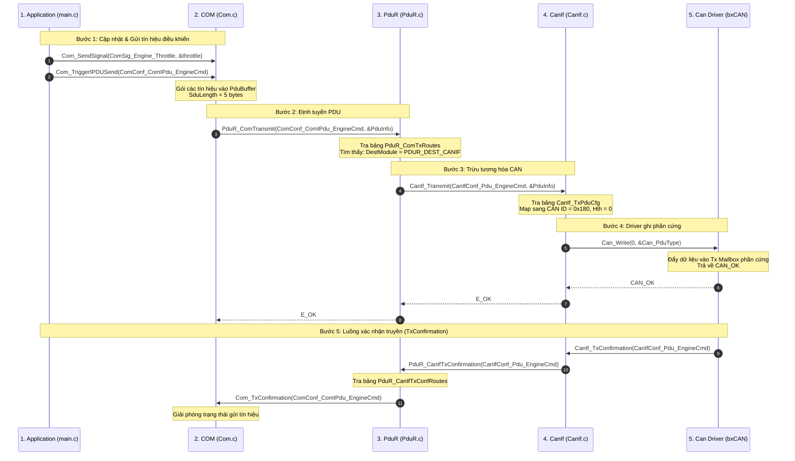
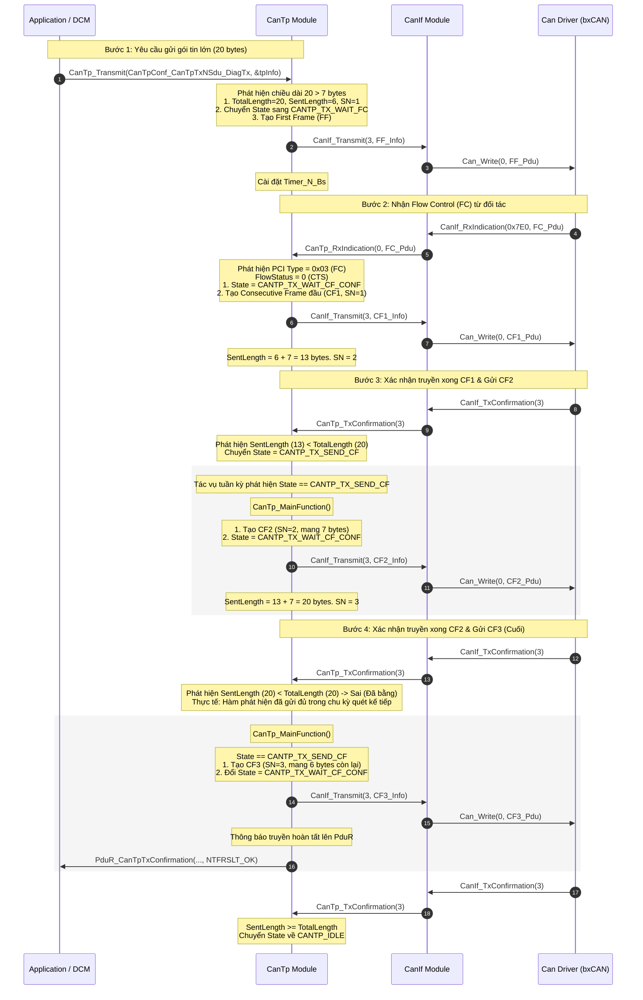
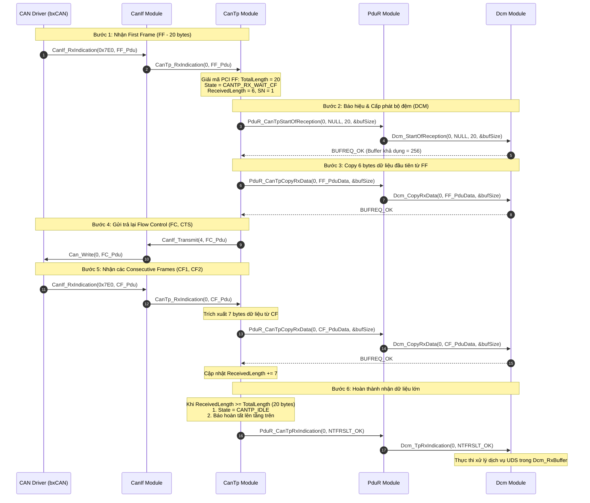

# Kịch Bản Tích Hợp & Luồng Xử Lý Đồng Bộ COM Stack

Tài liệu này trình bày chi tiết và hệ thống hóa 3 kịch bản truyền/nhận dữ liệu thực tế chạy trong project. Mỗi kịch bản mô tả dòng chảy dữ liệu đồng bộ xuyên suốt từ các tầng trên cùng (**App/COM/Dcm**) đi qua bộ định tuyến **PduR**, tầng vận chuyển **CanTp**, tầng trừu tượng **CanIf**, xuống Driver phần cứng **Can (MCAL)** và luồng phản hồi/chuyển tiếp ngược lại từ dưới lên trên.

---

## 1. Bản Đồ Tổng Quan Sự Tương Tác Giữa Các Lớp (Call Stack Map)

```
  TẦNG DỊCH VỤ (Service Layer)
    [COM]                     [DCM]
      │                         │
      │ PduR_ComTransmit()      │ CanTp_Transmit() / Dcm_StartOfReception()
      ▼                         ▼
  TẦNG ĐỊNH TUYẾN (Routing Layer)
    [PduR] <─────────────────> [PduR_CanTp...]
      │ PduR_ComTransmit()      │
      ▼ (Định tuyến trực tiếp)  │
  TẦNG VẬN CHUYỂN (Transport Layer)
      │                         │ PduR_CanTpCopyRxData() / PduR_CanTpRxIndication()
      │                         ▼
      │                      [CanTp]
      │                         │ CanIf_Transmit() (FF, CF, FC)
      │                         ▼
  TẦNG TRỪU TƯỢNG PHẦN CỨNG (ECU Abstraction Layer)
    [CanIf] <───────────────────┘
      │ Can_Write()
      ▼
  TẦNG MCAL DRIVER (Microcontroller Abstraction Layer)
    [Can Driver] (bxCAN)
```

---

## 2. Kịch Bản 1: Truyền Tín Hiệu CAN Cổ Điển Nhỏ Từ COM (Luồng TX)
*Kịch bản này mô tả quá trình gửi tín hiệu điều khiển động cơ `EngineCmd` (CAN ID `0x180`, độ dài 5 bytes) từ ứng dụng đi xuống và quá trình nhận xác nhận.*



### Chi tiết hành vi API đồng bộ (Kịch bản 1):
1.  **`Com_SendSignal`**: Ghi giá trị `throttle` mới vào Shadow Buffer nội bộ của COM tại tín hiệu [ComSig_Engine_Throttle](file:///Users/phamvanvu/HALAAcademy/01_Courses/Autosar%20Classic/COM/config/Com_Cfg.h).
2.  **`Com_TriggerIPDUSend`**: Bắt đầu đóng gói toàn bộ các bit tín hiệu của PDU [ComConf_ComIPdu_EngineCmd](file:///Users/phamvanvu/HALAAcademy/01_Courses/Autosar%20Classic/COM/config/Com_Cfg.h) vào bộ đệm gửi tĩnh. Sau đó gọi hàm định tuyến:
    *   **Call Stack**: `Com_TriggerIPDUSend` -> `PduR_ComTransmit(0, &info)`.
3.  **`PduR_ComTransmit`**: Thực hiện tìm kiếm tuyến trong bảng tĩnh `PduR_ComTxRoutes`. Định tuyến phát hiện Destination là `PDUR_DEST_CANIF`.
    *   **Call Stack**: `PduR_ComTransmit` -> `CanIf_Transmit(CanIfConf_Pdu_EngineCmd, PduInfoPtr)`.
4.  **`CanIf_Transmit`**: Tìm kiếm cấu hình PDU trong `CanIf_TxPduCfg`. Thiết lập cấu trúc Driver `Can_PduType` (chứa `id=0x180`, `length=5`, con trỏ dữ liệu).
    *   **Call Stack**: `CanIf_Transmit` -> `Can_Write(0, &frame)`.
5.  **`Can_Write`**: Thực hiện ghi vào thanh ghi bộ đệm truyền phần cứng (bxCAN). Trả về `CAN_OK`.
6.  **`Can_MainFunction_Write`**: Chạy ngắt/polling kiểm tra cờ truyền phần cứng xong. Gọi ngược lên:
    *   `CanIf_TxConfirmation(CanIfConf_Pdu_EngineCmd)` -> `PduR_CanIfTxConfirmation` -> `Com_TxConfirmation`.

---

## 3. Kịch Bản 2: Truyền Chẩn Đoán Dữ Liệu Lớn Phân Mảnh (UDS TX - Luồng CanTp)
*Kịch bản này mô tả ứng dụng gửi gói tin chẩn đoán UDS dài 20 bytes (kích thước lớn hơn 8 bytes tối đa của CAN Classic). Quá trình diễn ra đồng bộ qua cơ chế phân đoạn (First Frame -> Chờ nhận Flow Control -> Gửi Consecutive Frames).*



### Chi tiết hành vi API đồng bộ (Kịch bản 2):
1.  **`CanTp_Transmit`**:
    *   Hàm nhận vào ID cấu hình `CanTpConf_CanTpTxNSdu_DiagTx` (Index 0).
    *   Copy 20 bytes dữ liệu chẩn đoán vào buffer tĩnh `TxState[0].TxBuffer`.
    *   Dựng PCI First Frame: `Byte 0 = 0x10`, `Byte 1 = 0x14` (Hex của 20).
    *   Gửi 6 bytes đầu tiên của `DiagTx` qua `CanIf_Transmit(3, &canIfTxInfo)` (Index 3 là ID CAN `0x7E0` của chẩn đoán).
    *   Đặt `TxState[0].State = CANTP_TX_WAIT_FC`.
2.  **`CanTp_RxIndication` (Nhận Flow Control)**:
    *   Được gọi khi bên nhận phản hồi frame FC (CAN ID `0x7E0`).
    *   Phân tích byte PCI đầu tiên `0x30` -> CTS (Clear to Send).
    *   Đổi trạng thái: `TxState[0].State = CANTP_TX_WAIT_CF_CONF`.
    *   Gửi trực tiếp CF1 (SN=1) mang 7 bytes tiếp theo (Tổng bytes đã gửi = 13).
3.  **`CanTp_TxConfirmation` & `CanTp_MainFunction` (Pacing gửi CF)**:
    *   Mỗi khi Driver hoàn thành truyền 1 frame trên bus, callback `CanTp_TxConfirmation` đổi trạng thái kênh truyền sang `CANTP_TX_SEND_CF`.
    *   `CanTp_MainFunction` chạy ngầm định kỳ quét và phát hiện trạng thái `CANTP_TX_SEND_CF`, thực hiện gửi CF tiếp theo (CF2, CF3) và đưa trạng thái về `CANTP_TX_WAIT_CF_CONF` để chờ xác nhận tiếp theo từ phần cứng.
    *   Khi byte cuối cùng được truyền đi, báo cáo thành công lên `PduR` và giải phóng máy trạng thái về `CANTP_IDLE`.

---

## 4. Kịch Bản 3: Nhận Dữ Liệu Lớn & Lắp Ráp Lên DCM (UDS RX - Luồng CanTp)
*Kịch bản này mô tả quá trình nhận và lắp ráp gói dữ liệu chẩn đoán 20 bytes từ mạng CAN bên ngoài đi lên tầng Dcm chẩn đoán.*



### Chi tiết hành vi API đồng bộ (Kịch bản 3):
1.  **`CanIf_RxIndication`**: Nhận dạng CAN ID nhận được thuộc dải chẩn đoán (`0x7E0`), chuyển tiếp trực tiếp sang tầng vận chuyển bằng cách gọi:
    *   `CanIf_RxIndication` -> `CanTp_RxIndication(0, PduInfoPtr)`.
2.  **`CanTp_RxIndication` (Xử lý FF)**:
    *   Đọc byte PCI phát hiện First Frame (`PCI = 0x01`).
    *   Giải mã tổng dung lượng `totalRxLength = ((Byte0 & 0x0F) << 8) | Byte1`.
    *   Đưa trạng thái kênh nhận: `RxState.State = CANTP_RX_WAIT_CF`.
    *   Giao tiếp với DCM để xin cấp phát bộ đệm: gọi `PduR_CanTpStartOfReception()`. DCM cấp phát thành công và trả về kích thước đệm khả dụng qua con trỏ `bufferSizePtr`.
    *   Sao chép 6 bytes dữ liệu đầu tiên đi kèm trong FF trực tiếp lên DCM bằng hàm `PduR_CanTpCopyRxData()`.
    *   Tự động kích hoạt phản hồi Flow Control (CTS, BlockSize, STmin) để báo cho bên gửi tiếp tục gửi các mảnh dữ liệu tiếp theo qua CAN bus.
3.  **`CanTp_RxIndication` (Xử lý CF)**:
    *   Mỗi khi nhận được Consecutive Frame, kiểm tra trạng thái đang chờ CF.
    *   Lọc bỏ 1 byte PCI ở đầu CF, trích xuất dữ liệu payload thô (tối đa 7 bytes).
    *   Gọi `PduR_CanTpCopyRxData()` để sao chép trực tiếp dữ liệu thô này vào phân vùng kế tiếp của `Dcm_RxBuffer` (Không copy qua buffer trung gian của CanTp).
    *   Khi `ReceivedLength` đạt đến `TotalLength` (20 bytes), gọi `PduR_CanTpRxIndication(..., NTFRSLT_OK)`.
4.  **`Dcm_TpRxIndication`**: DCM nhận được chỉ thị kết thúc quá trình nhận dữ liệu thành công. Nó ngay lập tức giải mã gói tin (ví dụ: Service ID của dịch vụ UDS) và in log hiển thị dữ liệu ra màn hình Debug.
