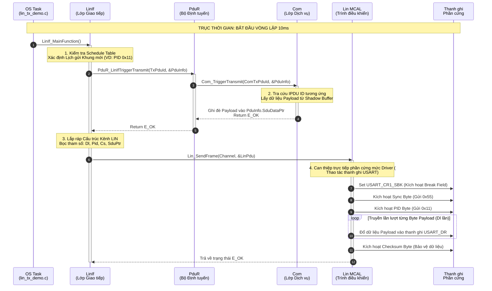

# Giáo trình Kỹ thuật: Phân tích Luồng Dữ liệu AUTOSAR LIN (Từ OS đến MCAL UART)

Tài liệu này được biên soạn phục vụ mục đích giảng dạy, tập trung phân tích sâu vào kiến trúc Kéo (Pull/Time-Triggered) của giao thức LIN trong tiêu chuẩn AUTOSAR Classic. Chúng ta sẽ theo dõi hành trình của một gói dữ liệu từ khi được hệ điều hành (OS) khởi xướng cho tới khi được xuất ra chân vi điều khiển dưới dạng xung điện.

---

## 1. Tổng quan Kiến trúc AUTOSAR LIN
Trái ngược với CAN sử dụng cơ chế *Sự kiện (Event-Triggered/Push)*, phương thức truyền thông của LIN Master yêu cầu tính tiền định cao và tuân thủ chặt chẽ **Bảng Lịch trình (Schedule Table)**. Dữ liệu sẽ không được tự động đẩy từ ứng dụng xuống thẳng ngoại vi, mà thay vào đó bộ Lập lịch (Scheduler) sẽ **chủ động Kéo (Pull)** dữ liệu từ các lớp phía trên khi tới đúng khe thời gian (Slot) được cấp phát. 

Chuỗi cung ứng dữ liệu sẽ đi qua các lớp BSW theo thứ tự:
`OS Task` $\rightarrow$ `LinIf` $\rightarrow$ `PduR` $\rightarrow$ `Com` $\mathbf{\rightarrow}$ `LinIf` $\rightarrow$ `Lin (MCAL)` $\rightarrow$ `UART Hardware`

---

## 2. Sơ đồ Trình tự (UML Sequence Flow)

Sơ đồ dưới đây minh hoạ chính xác các lời gọi hàm (API Calls) và sự dịch chuyển dữ liệu qua cấu trúc phân tầng AUTOSAR khi đến khe thời gian cấp phát truyền khung (VD: Khung gửi trạng thái Điều hòa - HVAC).

---

## 3. Chú giải Chi tiết Từng Giai đoạn (Step-by-Step Breakdown)

### Bước 1: Kích hoạt Trục Thời gian (OS Task)
- **Vị trí:** `example/lin_tx_demo.c`
- **Nguyên lý:** Hệ điều hành khởi tạo một chu kỳ lập lịch tĩnh (ví dụ: `delay_ms(10)` tương ứng `10ms` một vòng). Tại mỗi vòng, hàm `LinIf_MainFunction()` sẽ được gọi. Hàm này thay mặt module Master LIN quản lý toàn bộ phân bổ khe thời gian của mạng.

### Bước 2: Nhận diện Lịch và Kích hoạt Cơ chế Kéo (Pull Mechanism)
- **Vị trí:** `autosar/linif/LinIf.c`
- **Nguyên lý:** Bên trong `LinIf_MainFunction`, con trỏ Scheduler (Bộ Lập lịch) tiến lên 1 bước.
- Nếu Slot hiện tại yêu cầu phát một khung Master chứa Dữ liệu (Master-Node Transmit), `LinIf` sẽ tạo một vùng nhớ đệm rỗng. Sau đó, nó yêu cầu cấp dữ liệu bằng cách gọi hàm `PduR_LinIfTriggerTransmit`.

### Bước 3: Định tuyến và Trích xuất Dữ liệu Kéo (Routing & IPDU Extraction)
- **Vị trí:** `autosar/pdur/PduR.c` & `autosar/com/Com.c`
- **Nguyên lý:** 
  - Module `PduR` đóng vai trò bưu điện, tra bảng định tuyến và chuyển tiếp yêu cầu kéo dữ liệu thẳng lên cho cục `COM` với hàm `Com_TriggerTransmit`.
  - Bên trong tầng `COM`, vì là mạng được cấu hình Tích trưc (Shadow buffered), dữ liệu mới nhất (Ví dụ: trạng thái công tắc điều hòa) luôn được ghi vào bộ nhớ đệm trước đó bởi tầng Ứng dụng.
  - `COM` tìm đúng ID IPDU tương ứng, lập tức sao chép nội dung payload vào vùng đệm ảo của `LinIf` và xác nhận thành công.

### Bước 4: Đóng gói Định dạng Giao thức (LinIf Encapsulation)
- **Vị trí:** `autosar/linif/LinIf.c`
- **Nguyên lý:** Payload khô sơ từ `COM` chưa thể đưa xuống đường truyền tín hiệu linh kiện ngay. `LinIf` chịu trách nhiệm tổng hợp gói tin (Bọc Header) thành một biến cấu trúc chung `Lin_PduType`, bao gồm:
  1. `Dl` (Data Length): Số byte payload.
  2. `Pid` (Protected Identifier): Bao gồm 6-bit mã khung ID và 2-bit mã nội suy Parity.
  3. `Cs` (Checksum Model): Chọn cách tính là Classic hay Enhanced.
  4. `SduPtr`: Trỏ vào vùng nhớ lấy từ `COM`.

### Bước 5: Bơm ra Ngoại vi Phần Cứng (MCAL Driver)
- **Vị trí:** `autosar/lin/Lin.c`
- **Nguyên lý:** Hàm `Lin_SendFrame()` đại diện cho ngưỡng cửa cuối cùng trước khi chạm vào Silicon chip. Nó tính toán Checksum tổng thể và chỉ huy thanh ghi (Register) của phần cứng `USART`:
  1. **Tạo mồi phá vỡ:** Set thanh ghi CR (Control Register) lên cờ `USART_CR1_SBK`. MCU chủ động giữ chân TX ở ngưỡng Dominant (`LOW`) suốt độ dài $\ge 13$ bit để đánh thức mọi Slave (Break).
  2. **Đồng bộ hóa nhịp:** Đổ Byte bù trôi dạt `0x55` (`0b01010101`) vào khối chứa (`USART_DR`) và chờ tín hiệu hoàn lại (TXE flag) phần cứng.
  3. **Phát mạng lệnh và thân tin:** Gửi byte PID, tiếp sau là vòng lặp dội toàn bộ mảng dữ liệu lấy từ tầng COM.
  4. **Chốt chặn:** Nhét Checksum vào byte cuối. Giao thức khung LIN hoàn tất tại cấp độ Bit vật lý. Tín hiệu số truyền đi liền mạch!
