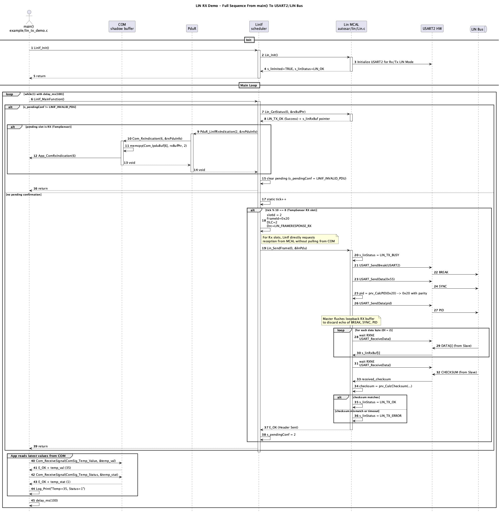
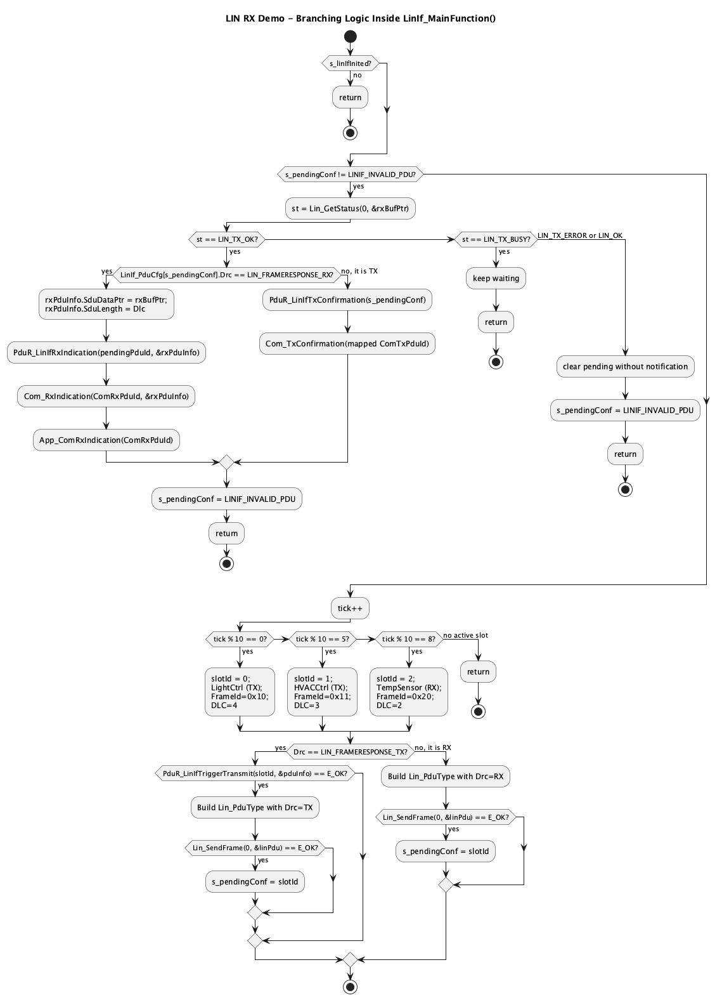

# Giáo trình Kỹ thuật: Phân tích Luồng Nhận Dữ liệu AUTOSAR LIN Rx (Từ MCAL UART đến COM)

Tài liệu này được biên soạn nhằm phân tích sâu vào cơ chế **Master Receive (Nhận phản hồi từ Slave)** của giao thức LIN trong tiêu chuẩn AUTOSAR Classic. Chúng ta sẽ tìm hiểu hành trình của một gói dữ liệu cảm biến được Slave gửi lên bus, sau đó được Driver MCAL thu nhận qua USART, kiểm tra Checksum, và đẩy ngược lên qua tầng BSW (`LinIf` $\rightarrow$ `PduR` $\rightarrow$ `COM`) tới ứng dụng.

---

## 1. Tổng quan Kiến trúc LIN Master Receive (Rx)

Trái ngược với luồng Tx nơi Master chủ động gửi cả Header lẫn Payload (Response), luồng nhận **LIN Rx** yêu cầu Master thực hiện hai nhiệm vụ kế tiếp nhau:
1.  **Phát lệnh (Header Generation)**: Master phát ra **Break Field**, **Sync Byte (0x55)**, và **PID** tương ứng với khung dữ liệu cần nhận.
2.  **Thu nhận (Response Reception)**: Master giải phóng đường truyền (đưa chân TX về trạng thái Recessive), chuyển sang chế độ lắng nghe trên chân RX để nhận byte dữ liệu và byte Checksum từ Slave truyền lên.

Dữ liệu nhận được từ bus sẽ di chuyển ngược từ dưới lên trên qua các lớp BSW:
`UART Hardware` $\rightarrow$ `Lin (MCAL)` $\rightarrow$ `LinIf` $\rightarrow$ `PduR` $\rightarrow$ `Com` $\rightarrow$ `Application`

---

## 2. Sơ đồ Trình tự & Lưu đồ Hoạt động (Visual Diagrams)

Dưới đây là các sơ đồ trực quan thể hiện chi tiết luồng xử lý nhận dữ liệu LIN Rx.

### A. Sơ đồ Trình tự (Sequence Diagram)
Sơ đồ trình tự dưới đây mô tả chính xác các lời gọi hàm (API Calls) và luồng đi của dữ liệu từ khi ứng dụng/OS kích hoạt chu kỳ nhận (ví dụ: lấy dữ liệu từ cảm biến nhiệt độ `TempSensor` - PID `0x20`) cho đến khi cập nhật vào tầng ứng dụng:



### B. Lưu đồ Hoạt động tại LinIf_MainFunction (Flowchart)
Lưu đồ dưới đây mô tả chi tiết các nhánh xử lý (phát lệnh Header Rx, chờ xác nhận kết quả, đẩy dữ liệu qua PduR/COM) diễn ra bên trong hàm quét chu kỳ `LinIf_MainFunction()`:



---

## 3. Phân tích Chi tiết Từng Giai đoạn (Step-by-Step Breakdown)

### Bước 1: Quản lý Lập lịch & Phát lệnh (LinIf & Lin MCAL)
- **Vị trí:** `autosar/linif/LinIf.c` và `autosar/lin/Lin.c`
- **Nguyên lý:**
  - `LinIf_MainFunction()` quét Schedule Table giả lập. Khi đến khe thời gian dành cho việc nhận dữ liệu (Rx Slot), nó sẽ đóng gói cấu trúc `Lin_PduType` với thuộc tính hướng phản hồi là `Drc = LIN_FRAMERESPONSE_RX`.
  - Hàm `Lin_SendFrame()` được gọi. Driver MCAL điều khiển UART phát đi Header (Break $\rightarrow$ Sync $\rightarrow$ PID).

### Bước 2: Loại bỏ Echo & Đọc Dữ liệu từ Bus (Lin MCAL)
- **Vị trí:** `autosar/lin/Lin.c`
- **Nguyên lý:**
  - Do cơ chế loopback vật lý của bộ thu phát LIN (LIN Transceiver), các byte mà Master phát ra (Sync, PID) cũng sẽ tự động xuất hiện trong bộ đệm nhận RX của UART. Driver phải thực hiện **đọc và xóa (flush)** toàn bộ dữ liệu này trước khi Slave bắt đầu gửi dữ liệu phản hồi.
  - Driver chạy vòng lặp đọc `Dl` byte dữ liệu + 1 byte Checksum qua cờ `USART_FLAG_RXNE` kèm theo bộ đếm **Timeout** để tránh block CPU vĩnh viễn trong trường hợp Slave bị ngắt kết nối hoặc không phản hồi.

### Bước 3: Kiểm tra Checksum & Cập nhật Trạng thái (Lin MCAL)
- **Vị trí:** `autosar/lin/Lin.c`
- **Nguyên lý:**
  - Driver sử dụng hàm `prv_CalcChecksum` để tính toán Checksum từ `PID` và các byte dữ liệu nhận được (Enhanced Checksum).
  - Nếu kết quả trùng khớp với byte Checksum nhận được, biến trạng thái nội bộ `s_linStatus` được gán bằng `LIN_TX_OK`.
  - Nếu xảy ra lỗi Checksum hoặc hết thời gian chờ (Timeout), trạng thái sẽ là `LIN_TX_ERROR`.

### Bước 4: Kiểm tra Trạng thái & Định tuyến Lên Tầng Trên (LinIf & PduR)
- **Vị trí:** `autosar/linif/LinIf.c` và `autosar/pdur/PduR.c`
- **Nguyên lý:**
  - Trong chu kỳ quét kế tiếp của `LinIf_MainFunction()`, hệ thống phát hiện có PDU đang chờ xác nhận (`s_pendingConf`). Nó gọi `Lin_GetStatus()` để kiểm tra trạng thái phần cứng.
  - Khi nhận được trạng thái `LIN_TX_OK`, nếu PDU đó được cấu hình là Rx (`Drc == LIN_FRAMERESPONSE_RX`), `LinIf` sẽ trích xuất con trỏ buffer dữ liệu nhận được và gọi `PduR_LinIfRxIndication()` để báo hiệu lên PduR.
  - Tầng định tuyến `PduR` tra bảng định cấu hình Rx (`PduR_LinIfRxRoutes`), ánh xạ ID từ lớp dưới lên lớp trên và đẩy tiếp lên `Com_RxIndication()`.

### Bước 5: Cập nhật Shadow Buffer & Thông báo Ứng dụng (COM & App)
- **Vị trí:** `autosar/com/Com.c` và `example/lin_tx_demo.c`
- **Nguyên lý:**
  - Tầng `COM` tiếp nhận dữ liệu thông qua hàm `Com_RxIndication()`, thực hiện sao chép (memcpy) dữ liệu thô vào bộ đệm tĩnh của PDU nhận tương ứng (`Com_IpduBuf`).
  - Gọi callback `App_ComRxIndication()` thông báo cho ứng dụng biết dữ liệu mới đã sẵn sàng.
  - Ứng dụng (SWC) sử dụng API `Com_ReceiveSignal()` để bóc tách các tín hiệu (ví dụ: giá trị nhiệt độ, trạng thái cảm biến) từ PDU này để xử lý logic.

---

## 4. Đặc tả Cấu hình Mẫu cho Khung LIN Rx (TempSensor)

Dưới đây là sơ đồ ánh xạ cấu hình mẫu được triển khai để kiểm thử khung nhận dữ liệu nhiệt độ cảm biến:

### A. Cấu hình tại COM Layer (`Com_Cfg.h` & `Com_Cfg.c`)
- **I-PDU ID**: `ComConf_ComIPdu_TempSensor = 6u` (Hướng `COM_PDU_DIR_RX`, Độ dài = 2 bytes).
- **Tín hiệu con**:
  - `ComSig_Temp_Value = 19u` (Bắt đầu tại Byte 0, Độ dài = 8 bits).
  - `ComSig_Temp_Status = 20u` (Bắt đầu tại Byte 1, Độ dài = 8 bits).

### B. Cấu hình tại Routing Layer (`PduR_Cfg.h` & `PduR_Cfg.c`)
- Đăng ký bảng route `PduR_LinIfRxRoutes` gồm 1 phần tử:
  ```c
  const PduR_CallbackRouteType PduR_LinIfRxRoutes[1] = {
      { LinIfConf_Pdu_TempSensor, ComConf_ComIPdu_TempSensor }
  };
  ```

### C. Cấu hình tại Interface Layer (`LinIf.c`)
- Đăng ký PDU thứ 3 trong lịch trình quét:
  ```c
  static const LinIf_PduCfgType LinIf_PduCfg[3] = {
      ...
      { .LinIfPduId = 2u, .LinFrameId = 0x20u, .Dlc = 2u, .Drc = LIN_FRAMERESPONSE_RX } // TempSensor
  };
  ```
- **Schedule Table**:
  - `tick % 10 == 0`: Phát LightCtrl (TX).
  - `tick % 10 == 5`: Phát HVACCtrl (TX).
  - `tick % 10 == 8`: Yêu cầu nhận dữ liệu từ cảm biến `TempSensor` (RX).
